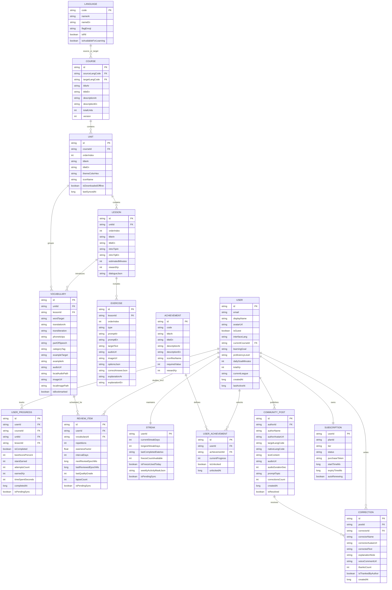

# تطبيق "لِسان (Lisaan)" — المرحلة 1: وثيقة المنتج (PRD)، الهوية البصرية، شجرة الشاشات، مخطط قاعدة البيانات (ER Diagram)، وهيكل الحزم مع كود Room الكامل

---

## 1. وثيقة متطلبات المنتج المختصرة (Product Requirements Document - PRD)

### 1.1 الرؤية والهدف (Vision & Value Proposition)
**"لِسان (Lisaan)"** هو تطبيق أندرويد أصيل لتعلّم اللغات مبني خصيصاً ليربط المتعلم العربي باللغات العالمية (بدءاً باللغة الإنجليزية للناطقين بالعربية) عبر منهجية **"الاكتساب التفاعلي المتدرج"**: دمج التعلّم المهيكل عبر خريطة رحلات، التكرار المتباعد الخوارزمي (SM-2)، المحادثة الذكية الفورية (Claude AI Coach)، والتصحيح المجتمعي التشاركي من متحدثين أصليين ومتعلمين متقدمين.

### 1.2 المبادئ التصميمية والهوية البصرية الأصلية (Original Brand Identity)
* **الاسم:** **لِسان (Lisaan)** — مستوحى من الفصاحة والقدرة على التواصل البشري الحي.
* **الشعار (Logo Concept):** حرف **"ل"** عربي منساب يتقاطع مع فقاعة حوار وموجة صوتية متناغمة، يرمز للنطق والحوار العابر للثقافات.
* **التميمة الأصلية (Original Mascot):** **"نَبيه (Nabeeh)"** — طائر هدهد ذكي بملامح هندسية عصرية مبسطة (Flat Vector Illustration) يرتدي وشاحاً بلون اللازورد ويحمل عدسة/بوصلة لغوية صغيرة. الهدهد في الثقافة العربية رمز البحث والمعرفة ونقل الرسائل بين الحضارات.
  * **حالات نبيه (Lottie Animation States):**
    1. `nabeeh_idle.json`: يرفرف بهدوء ويحرّك عرفه بفضول (شاشة الـ Home والـ Onboarding).
    2. `nabeeh_celebrate.json`: يقفز ويفتح جناحيه مع نجوم كهرمانية عند الإجابة الصحيحة أو إتمام الدرس.
    3. `nabeeh_thinking.json`: يميل برأسه ويفكر أثناء انتظار ردّ الـ AI Coach أو أثناء نطق المستخدم.
    4. `nabeeh_encourage.json`: يربّت بجناحه بلطف عند الإجابة الخاطئة دون إحباط المتعلم.
    5. `nabeeh_streak_fire.json`: يرفع شعلة كهرمانية متوهجة عند الحفاظ على الـ Streak اليومي.
* **لوحة الألوان الأصلية (Desert Oasis & Lapis Palette):**
  * **Primary (أزرق لازوردي عميق - Lapis Lazuli):** `#0F4C81` (Light) / `#7CC0FF` (Dark) — يعكس العمق المعرفي والثقة.
  * **Secondary (أخضر واحة زمردي - Oasis Emerald):** `#00897B` (Light) / `#4DB6AC` (Dark) — يعكس النمو والتقدم.
  * **Tertiary / Accent (كهرماني رملي مشرق - Warm Amber):** `#F59E0B` (Light) / `#FBBF24` (Dark) — للـ Streak، نقاط XP، والتنبيهات التحفيزية.
  * **Semantic Colors:**
    * Success: `#10B981`
    * Warning: `#F59E0B`
    * Error: `#EF4444`
  * **Background & Surface:**
    * Light Mode: Background `#FAF8F5` (ورقي رملي دافئ مريح للعين في القراءة)، Surface `#FFFFFF`.
    * Dark Mode: Background `#0B131E` (ليلي كحلي داكن)، Surface `#152232`.
* **الخطوط (Typography):**
  * **العربية:** خط **IBM Plex Sans Arabic** (أوزان: Regular 400, Medium 500, SemiBold 600, Bold 700) — يتميز بوضوح الحركات والتشكيل والمسافات المريحة.
  * **اللاتينية (الإنجليزية):** خط **Plus Jakarta Sans** — هندسي واضح جداً في قراءة المفردات والجمل الصوتية (Phonetics).

### 1.3 مؤشرات الأداء ومسارات التحليلات (Key Metrics & Analytics Funnels)
1. **Onboarding Funnel:** `onboarding_started` -> `interface_lang_selected` -> `target_lang_selected` -> `goal_selected` -> `level_or_placement_completed` -> `daily_goal_set` -> `notifications_prompted` -> `onboarding_completed`.
2. **Learning Loop Funnel:** `lesson_started` -> `vocab_card_viewed` -> `exercise_answered` (مع نوع التمرين والنتيجة) -> `lesson_completed` -> `xp_earned` -> `streak_updated`.
3. **Retention & Smart Review Funnel:** `sm2_session_started` -> `sm2_card_graded` -> `sm2_session_completed`.
4. **Monetization Funnel:** `paywall_viewed` (مع المصدر: AI Coach / Offline / Unlimited Hearts) -> `plan_selected` -> `purchase_initiated` -> `purchase_succeeded` / `purchase_restored`.

---

## 2. شجرة الشاشات الكاملة (Complete Screen Tree & Navigation Hierarchy)

```text
LisaanRootApp (Compose Navigation Host - Supports Full RTL/LTR & Deep Links)
├── 0. Splash / Startup Router (Checks Auth & Onboarding State via DataStore)
│
├── 1. Onboarding Flow (NavGraph: "onboarding_graph")
│   ├── 1.1 IntroPagerScreen (3 صفحات تعريفية بهوية "لِسان" والهدهد "نبيه")
│   ├── 1.2 InterfaceLanguageScreen (اختيار لغة الواجهة: العربية / English مع تبديل فوري للـ Locale وRTL)
│   ├── 1.3 TargetLanguageScreen (اختيار اللغة المتعلمة: الإنجليزية كبداية + لغات قريباً)
│   ├── 1.4 LearningGoalScreen (اختيار الهدف: سفر ✈️ / عمل 💼 / دراسة 🎓 / هواية وثقافة 🎨)
│   ├── 1.5 LevelSelectionScreen (اختيار المستوى: مبتدئ A1 / متوسط A2-B1 / أو "اختبر مستواي")
│   ├── 1.6 PlacementTestScreen (اختبار تحديد مستوى تكيّفي من 10 أسئلة متدرجة الصعوبة)
│   ├── 1.7 DailyGoalScreen (اختيار الهدف اليومي: 5 د / 10 د / 15 د / 20 د)
│   └── 1.8 NotificationOptInScreen (تفعيل التذكير الذكي وتحديد وقت التذكير المفضل)
│
├── 2. Auth Flow (NavGraph: "auth_graph")
│   ├── 2.1 WelcomeAuthScreen (تسجيل بإيميل، Google Sign-In، أو الدخول كضيف Guest)
│   ├── 2.2 EmailSignInScreen (تسجيل دخول بالبريد وكلمة المرور)
│   ├── 2.3 EmailSignUpScreen (إنشاء حساب جديد + ربط بيانات الـ Onboarding)
│   └── 2.4 ForgotPasswordScreen (إرسال رابط استعادة كلمة المرور عبر Firebase Auth)
│
├── 3. Main Scaffold (Bottom Navigation Bar - 5 Tabs)
│   ├── Tab 1: Home / Learning Path ("home_route")
│   │   ├── 3.1.1 HomePathScreen
│   │   │   ├── TopBar: Language Switcher, Streak Counter 🔥, XP Counter ⚡, Offline Sync Indicator ☁️
│   │   │   ├── DailyGoalProgressCard + Floating CTA Button ("كمّل من حيث وقفت")
│   │   │   ├── Interactive Map Path: Units -> Nodes (Lessons: Locked, Current, Completed with Stars)
│   │   │   └── MiniGamesEntryBanner (الوصول السريع للألعاب المصغرة)
│   │   └── 3.1.2 UnitOfflineDownloadSheet (تحميل الوحدة كاملة بالصوتيات والصور للأوفلاين)
│   │
│   ├── Tab 2: Smart Review & Dictionary ("review_vocab_route")
│   │   ├── 3.2.1 SmartReviewHubScreen (عداد المفردات المستحقة للمراجعة اليوم وفق خوارزمية SM-2)
│   │   ├── 3.2.2 Sm2ReviewSessionScreen (جلسة تكرار متباعد بتقييم: صعب جداً / صعب / جيد / سهل)
│   │   ├── 3.2.3 MyDictionaryScreen (قاموسي: بحث فوري، فلترة بالتصنيفات والوحدات، المفضلة)
│   │   ├── 3.2.4 FlashcardsDeckScreen (استعراض الكلمات بنظام بطاقات الوجهين Flip Cards مع النطق)
│   │   └── 3.2.5 MiniGamesHubScreen (الألعاب المصغرة)
│   │       ├── SpeedMatchGameScreen (مطابقة سريعة ضد الوقت)
│   │       ├── WordSprintGameScreen (سباق كلمات متساقطة)
│   │       └── GuessPictureGameScreen (تخمين الصورة من 4 خيارات صوتية/نصية)
│   │
│   ├── Tab 3: AI Conversation Coach ("ai_coach_route")
│   │   ├── 3.3.1 AiScenariosScreen (اختيار سيناريو: في المطار، مقابلة عمل، في المطعم، محادثة حرة)
│   │   └── 3.3.2 AiChatSessionScreen
│   │       ├── رسائل دردشة نصية وصوتية (TTS + SpeechRecognizer)
│   │       ├── بطاقة التصحيح الفوري (Grammar & Vocabulary Correction Card) مع شرح مبسط بالعربية
│   │       └── ملخص الجلسة بعد الانتهاء ونقاط الـ XP المكتسبة
│   │
│   ├── Tab 4: Community & Challenges ("community_challenges_route")
│   │   ├── 3.4.1 CommunityFeedScreen (تبويبان: "ساعد غيرك" و"منشوراتي")
│   │   ├── 3.4.2 CreatePostScreen (نشر نص أو تسجيل صوتي حتى 60 ثانية لطلب تصحيح)
│   │   ├── 3.4.3 PostDetailCorrectionScreen (إضافة تصحيح سطري Diff، تعليق صوتي/نصي، زر شكر ❤️، إبلاغ 🚩)
│   │   ├── 3.4.4 LeaderboardScreen (الدوري الأسبوعي: برونز 🥉 / فضة 🥈 / ذهب 🥇 + قائمة الأصدقاء)
│   │   └── 3.4.5 AchievementsBadgesScreen (لوحة الأوسمة والإنجازات المحققة والمقفلة)
│   │
│   └── Tab 5: Profile & Settings ("profile_route")
│       ├── 3.5.1 ProfileOverviewScreen (الصورة، الاسم، إحصائيات التعلم، رسم بياني للأسبوع، الأوسمة)
│       ├── 3.5.2 SettingsScreen
│       │   ├── لغة الواجهة (عربي / إنجليزي)
│       │   ├── المظهر (فاتح / داكن / تلقائي حسب النظام)
│       │   ├── سرعة الصوت في الدروس (0.75x / 1.0x / 1.25x)
│       │   ├── إعدادات الإشعارات (التذكير اليومي، حماية الـ Streak، إشعارات المجتمع)
│       │   ├── إدارة التنزيلات الأوفلاين ومساحة التخزين
│       │   ├── إدارة الاشتراك (الترقية لـ Premium / استعادة المشتريات)
│       │   ├── الخصوصية والشروط + تواصل معنا
│       │   └── إدارة الحساب (ربط حساب الضيف، تسجيل الخروج، حذف الحساب نهائياً مع التأكيد)
│
├── 4. Lesson Player Flow (Full-Screen Modal NavGraph: "lesson_graph/{lessonId}")
│   ├── 4.1 LessonIntroPhase (عنوان الدرس، هدف التواصل، المفردات المفتاحية)
│   ├── 4.2 VocabularyCardsPhase (بطاقات مفردات بصور أصلية، نطق عادي وبطيء، مثال في جملة)
│   ├── 4.3 DialogueSentencesPhase (سياق حواري تطبيقي للجمل قبل الاختبار)
│   ├── 4.4 ExercisesEnginePhase (محرك التمارين الـ 8 المتتابعة مع شريط تقدم علوي وتغذية راجعة فورية)
│   │   ├── [1] MultipleChoiceExercise (اختيار من متعدد)
│   │   ├── [2] WrittenTranslationExercise (ترجمة بالكتابة مع تسامح الأخطاء الإملائية البسيطة Levenshtein)
│   │   ├── [3] WordOrderChipsExercise (ترتيب الكلمات المبعثرة لتكوين جملة)
│   │   ├── [4] MatchingPairsExercise (توصيل الأزواج: كلمة بترجمتها أو بصورتها)
│   │   ├── [5] FillInTheBlankExercise (ملء الفراغ في سياق جملة)
│   │   ├── [6] ListeningDictationExercise (استماع وكتابة مع زر إبطاء الصوت 🐢)
│   │   ├── [7] SpeakingPronunciationExercise (نطق عبر SpeechRecognizer مع حساب نسبة الدقة المئوية %)
│   │   └── [8] TrueFalseExercise (صح أم خطأ بناءً على جملة أو مقطع صوتي)
│   └── 4.5 LessonSummaryResultScreen (النتيجة النهائية، الدقة %، الوقت المستغرق، XP المكتسب، تحديث الـ Streak)
│
└── 5. Paywall & Subscription Flow ("paywall_graph")
    └── 5.1 PaywallScreen (مقارنة Free vs Lisaan Plus، خطط شهري/سنوي/مدى الحياة، زر استعادة المشتريات)
```

---

## 3. مخطط العلاقات لقاعدة البيانات (ER Diagram - Room & Firestore Sync)



---

## 4. هيكل الحزم الكامل (Clean Architecture + MVVM Package Structure)

```text
com.lisaan.app
├── LisaanApplication.kt
├── MainActivity.kt
├── core
│   ├── common
│   │   ├── Resource.kt
│   │   ├── DispatcherProvider.kt
│   │   ├── LocaleHelper.kt
│   │   └── DateTimeUtils.kt
│   ├── datastore
│   │   ├── UserPreferencesDataStore.kt
│   │   └── AppSettings.kt
│   ├── database
│   │   ├── LisaanDatabase.kt
│   │   ├── converters
│   │   │   └── RoomTypeConverters.kt
│   │   ├── entities
│   │   │   ├── UserEntity.kt
│   │   │   ├── LanguageEntity.kt
│   │   │   ├── CourseEntity.kt
│   │   │   ├── UnitEntity.kt
│   │   │   ├── LessonEntity.kt
│   │   │   ├── VocabularyEntity.kt
│   │   │   ├── ExerciseEntity.kt
│   │   │   ├── UserProgressEntity.kt
│   │   │   ├── ReviewItemEntity.kt
│   │   │   ├── StreakEntity.kt
│   │   │   ├── AchievementEntity.kt
│   │   │   ├── CommunityPostEntity.kt
│   │   │   ├── CorrectionEntity.kt
│   │   │   └── SubscriptionEntity.kt
│   │   ├── relations
│   │   │   └── DatabaseRelations.kt
│   │   ├── dao
│   │   │   ├── UserDao.kt
│   │   │   ├── CourseContentDao.kt
│   │   │   ├── VocabularyDao.kt
│   │   │   ├── ProgressAndStreakDao.kt
│   │   │   ├── Sm2ReviewDao.kt
│   │   │   ├── AchievementDao.kt
│   │   │   ├── CommunityDao.kt
│   │   │   └── SubscriptionDao.kt
│   │   └── migrations
│   │       └── DatabaseMigrations.kt
│   ├── network
│   │   ├── ClaudeAiApiService.kt
│   │   ├── AuthInterceptor.kt
│   │   └── NetworkMonitor.kt
│   ├── media
│   │   ├── LisaanAudioPlayer.kt (ExoPlayer wrapper)
│   │   ├── LisaanTtsManager.kt (Android TextToSpeech)
│   │   ├── LisaanSpeechRecognizer.kt (Speech-to-Text + Accuracy Scorer)
│   │   └── VoiceRecorderManager.kt (Community Audio Recording)
│   ├── sync
│   │   ├── OfflineProgressSyncWorker.kt
│   │   └── UnitDownloadWorker.kt
│   ├── notifications
│   │   ├── SmartReminderWorker.kt
│   │   ├── StreakSaverWorker.kt
│   │   └── LisaanFcmService.kt
│   ├── analytics
│   │   └── LisaanAnalyticsTracker.kt
│   └── designsystem
│       ├── theme
│       │   ├── Color.kt
│       │   ├── Type.kt
│       │   ├── Shape.kt
│       │   └── Theme.kt
│       └── components
│           ├── NabeehMascotView.kt
│           ├── LisaanButtons.kt
│           └── StateViews.kt (Loading / Empty / Error)
├── di
│   ├── AppModule.kt
│   ├── DatabaseModule.kt
│   ├── NetworkModule.kt
│   ├── FirebaseModule.kt
│   ├── MediaModule.kt
│   └── RepositoryModule.kt
├── domain
│   ├── model
│   │   └── DomainModels.kt
│   ├── repository
│   │   ├── AuthRepository.kt
│   │   ├── CourseRepository.kt
│   │   ├── Sm2ReviewRepository.kt
│   │   ├── AiCoachRepository.kt
│   │   ├── CommunityRepository.kt
│   │   └── BillingRepository.kt
│   └── usecase
│       ├── sm2
│       │   └── CalculateSm2ScheduleUseCase.kt
│       ├── lesson
│       │   ├── EvaluateExerciseAnswerUseCase.kt
│       │   └── CompleteLessonAndUpdateStreakUseCase.kt
│       └── placement
│           └── CalculatePlacementLevelUseCase.kt
├── data
│   ├── remote
│   │   ├── firestore
│   │   │   └── FirestoreDtos.kt
│   │   └── dto
│   │       └── AiCoachDtos.kt
│   ├── seed
│   │   └── LocalCourseSeedLoader.kt
│   └── repository
│       ├── AuthRepositoryImpl.kt
│       ├── CourseRepositoryImpl.kt
│       ├── Sm2ReviewRepositoryImpl.kt
│       ├── AiCoachRepositoryImpl.kt
│       ├── CommunityRepositoryImpl.kt
│       └── BillingRepositoryImpl.kt
└── presentation
    ├── navigation
    │   ├── ScreenRoutes.kt
    │   └── LisaanNavHost.kt
    ├── onboarding
    ├── auth
    ├── home
    ├── lesson
    ├── review
    ├── dictionary
    ├── minigames
    ├── aicoach
    ├── community
    ├── challenges
    ├── paywall
    └── profile
```

---

## 5. الكود الكامل لطبقة قاعدة البيانات (`Room Entities`, `Relations`, `TypeConverters`, `DAOs`, `Migrations`, `Firestore DTOs`)

فيما يلي الكود الكامل والجاهز للتشغيل لجميع الكيانات الـ 14، العلاقات، الـ DAOs، الـ Migrations، وقاعدة البيانات:

### 5.1 محولات الأنواع (`RoomTypeConverters.kt`)

```kotlin
package com.lisaan.app.core.database.converters

import androidx.room.TypeConverter
import org.json.JSONArray
import org.json.JSONObject

class RoomTypeConverters {

    @TypeConverter
    fun fromStringList(list: List<String>?): String {
        if (list == null) return "[]"
        val jsonArray = JSONArray()
        list.forEach { jsonArray.put(it) }
        return jsonArray.toString()
    }

    @TypeConverter
    fun toStringList(data: String?): List<String> {
        if (data.isNullOrBlank()) return emptyList()
        return try {
            val jsonArray = JSONArray(data)
            List(jsonArray.length()) { index -> jsonArray.getString(index) }
        } catch (e: Exception) {
            emptyList()
        }
    }

    @TypeConverter
    fun fromBooleanList(list: List<Boolean>?): String {
        if (list == null) return "[]"
        val jsonArray = JSONArray()
        list.forEach { jsonArray.put(it) }
        return jsonArray.toString()
    }

    @TypeConverter
    fun toBooleanList(data: String?): List<Boolean> {
        if (data.isNullOrBlank()) return emptyList()
        return try {
            val jsonArray = JSONArray(data)
            List(jsonArray.length()) { index -> jsonArray.getBoolean(index) }
        } catch (e: Exception) {
            emptyList()
        }
    }

    @TypeConverter
    fun fromStringMap(map: Map<String, String>?): String {
        if (map == null) return "{}"
        val jsonObject = JSONObject()
        map.forEach { (k, v) -> jsonObject.put(k, v) }
        return jsonObject.toString()
    }

    @TypeConverter
    fun toStringMap(data: String?): Map<String, String> {
        if (data.isNullOrBlank()) return emptyMap()
        return try {
            val jsonObject = JSONObject(data)
            val result = mutableMapOf<String, String>()
            val keys = jsonObject.keys()
            while (keys.hasNext()) {
                val key = keys.next()
                result[key] = jsonObject.optString(key, "")
            }
            result
        } catch (e: Exception) {
            emptyMap()
        }
    }
}
```

### 5.2 جميع كيانات قاعدة البيانات الـ 14 (`AllRoomEntities.kt`)

```kotlin
package com.lisaan.app.core.database.entities

import androidx.room.ColumnInfo
import androidx.room.Entity
import androidx.room.ForeignKey
import androidx.room.Index
import androidx.room.PrimaryKey

// 1. User Entity
@Entity(
    tableName = "users",
    indices = [Index(value = ["email"], unique = false)]
)
data class UserEntity(
    @PrimaryKey
    @ColumnInfo(name = "id") val id: String,
    @ColumnInfo(name = "email") val email: String?,
    @ColumnInfo(name = "display_name") val displayName: String,
    @ColumnInfo(name = "avatar_url") val avatarUrl: String?,
    @ColumnInfo(name = "is_guest") val isGuest: Boolean = false,
    @ColumnInfo(name = "interface_lang") val interfaceLang: String = "ar",
    @ColumnInfo(name = "current_course_id") val currentCourseId: String = "en_from_ar",
    @ColumnInfo(name = "learning_goal") val learningGoal: String = "TRAVEL", // TRAVEL, WORK, STUDY, HOBBY
    @ColumnInfo(name = "proficiency_level") val proficiencyLevel: String = "A1", // A1, A2, B1, B2
    @ColumnInfo(name = "daily_goal_minutes") val dailyGoalMinutes: Int = 10,
    @ColumnInfo(name = "total_xp") val totalXp: Int = 0,
    @ColumnInfo(name = "current_league") val currentLeague: String = "BRONZE", // BRONZE, SILVER, GOLD
    @ColumnInfo(name = "created_at") val createdAt: Long = System.currentTimeMillis(),
    @ColumnInfo(name = "last_active_at") val lastActiveAt: Long = System.currentTimeMillis()
)

// 2. Language Entity
@Entity(tableName = "languages")
data class LanguageEntity(
    @PrimaryKey
    @ColumnInfo(name = "code") val code: String, // "ar", "en"
    @ColumnInfo(name = "name_ar") val nameAr: String,
    @ColumnInfo(name = "name_en") val nameEn: String,
    @ColumnInfo(name = "flag_emoji") val flagEmoji: String,
    @ColumnInfo(name = "is_rtl") val isRtl: Boolean,
    @ColumnInfo(name = "is_available_for_learning") val isAvailableForLearning: Boolean
)

// 3. Course Entity
@Entity(
    tableName = "courses",
    foreignKeys = [
        ForeignKey(
            entity = LanguageEntity::class,
            parentColumns = ["code"],
            childColumns = ["source_lang_code"],
            onDelete = ForeignKey.CASCADE
        ),
        ForeignKey(
            entity = LanguageEntity::class,
            parentColumns = ["code"],
            childColumns = ["target_lang_code"],
            onDelete = ForeignKey.CASCADE
        )
    ],
    indices = [
        Index("source_lang_code"),
        Index("target_lang_code")
    ]
)
data class CourseEntity(
    @PrimaryKey
    @ColumnInfo(name = "id") val id: String, // "en_from_ar"
    @ColumnInfo(name = "source_lang_code") val sourceLangCode: String,
    @ColumnInfo(name = "target_lang_code") val targetLangCode: String,
    @ColumnInfo(name = "title_ar") val titleAr: String,
    @ColumnInfo(name = "title_en") val titleEn: String,
    @ColumnInfo(name = "description_ar") val descriptionAr: String,
    @ColumnInfo(name = "description_en") val descriptionEn: String,
    @ColumnInfo(name = "total_units") val totalUnits: Int,
    @ColumnInfo(name = "version") val version: Int = 1
)

// 4. Unit Entity
@Entity(
    tableName = "units",
    foreignKeys = [
        ForeignKey(
            entity = CourseEntity::class,
            parentColumns = ["id"],
            childColumns = ["course_id"],
            onDelete = ForeignKey.CASCADE
        )
    ],
    indices = [Index("course_id"), Index("order_index")]
)
data class UnitEntity(
    @PrimaryKey
    @ColumnInfo(name = "id") val id: String,
    @ColumnInfo(name = "course_id") val courseId: String,
    @ColumnInfo(name = "order_index") val orderIndex: Int,
    @ColumnInfo(name = "title_ar") val titleAr: String,
    @ColumnInfo(name = "title_en") val titleEn: String,
    @ColumnInfo(name = "subtitle_ar") val subtitleAr: String,
    @ColumnInfo(name = "subtitle_en") val subtitleEn: String,
    @ColumnInfo(name = "theme_color_hex") val themeColorHex: String = "#0F4C81",
    @ColumnInfo(name = "icon_name") val iconName: String = "ic_unit_compass",
    @ColumnInfo(name = "is_downloaded_offline") val isDownloadedOffline: Boolean = false,
    @ColumnInfo(name = "last_synced_at") val lastSyncedAt: Long = 0L
)

// 5. Lesson Entity
@Entity(
    tableName = "lessons",
    foreignKeys = [
        ForeignKey(
            entity = UnitEntity::class,
            parentColumns = ["id"],
            childColumns = ["unit_id"],
            onDelete = ForeignKey.CASCADE
        )
    ],
    indices = [Index("unit_id"), Index("order_index")]
)
data class LessonEntity(
    @PrimaryKey
    @ColumnInfo(name = "id") val id: String,
    @ColumnInfo(name = "unit_id") val unitId: String,
    @ColumnInfo(name = "order_index") val orderIndex: Int,
    @ColumnInfo(name = "title_ar") val titleAr: String,
    @ColumnInfo(name = "title_en") val titleEn: String,
    @ColumnInfo(name = "intro_tip_ar") val introTipAr: String,
    @ColumnInfo(name = "intro_tip_en") val introTipEn: String,
    @ColumnInfo(name = "estimated_minutes") val estimatedMinutes: Int = 5,
    @ColumnInfo(name = "reward_xp") val rewardXp: Int = 20,
    @ColumnInfo(name = "dialogue_json") val dialogueJson: String = "[]"
)

// 6. Vocabulary Entity
@Entity(
    tableName = "vocabularies",
    foreignKeys = [
        ForeignKey(
            entity = UnitEntity::class,
            parentColumns = ["id"],
            childColumns = ["unit_id"],
            onDelete = ForeignKey.CASCADE
        ),
        ForeignKey(
            entity = LessonEntity::class,
            parentColumns = ["id"],
            childColumns = ["lesson_id"],
            onDelete = ForeignKey.CASCADE
        )
    ],
    indices = [
        Index("unit_id"),
        Index("lesson_id"),
        Index("word_target"),
        Index("category_tag"),
        Index("is_bookmarked")
    ]
)
data class VocabularyEntity(
    @PrimaryKey
    @ColumnInfo(name = "id") val id: String,
    @ColumnInfo(name = "unit_id") val unitId: String,
    @ColumnInfo(name = "lesson_id") val lessonId: String,
    @ColumnInfo(name = "word_target") val wordTarget: String,
    @ColumnInfo(name = "translation_ar") val translationAr: String,
    @ColumnInfo(name = "transliteration") val transliteration: String,
    @ColumnInfo(name = "phonetic_ipa") val phoneticIpa: String,
    @ColumnInfo(name = "part_of_speech") val partOfSpeech: String, // NOUN, VERB, ADJ, PHRASE
    @ColumnInfo(name = "category_tag") val categoryTag: String, // GREETINGS, TRAVEL, WORK, FOOD, DAILY
    @ColumnInfo(name = "example_target") val exampleTarget: String,
    @ColumnInfo(name = "example_ar") val exampleAr: String,
    @ColumnInfo(name = "audio_url") val audioUrl: String?,
    @ColumnInfo(name = "local_audio_path") val localAudioPath: String? = null,
    @ColumnInfo(name = "image_url") val imageUrl: String?,
    @ColumnInfo(name = "local_image_path") val localImagePath: String? = null,
    @ColumnInfo(name = "is_bookmarked") val isBookmarked: Boolean = false
)

// 7. Exercise Entity
@Entity(
    tableName = "exercises",
    foreignKeys = [
        ForeignKey(
            entity = LessonEntity::class,
            parentColumns = ["id"],
            childColumns = ["lesson_id"],
            onDelete = ForeignKey.CASCADE
        )
    ],
    indices = [Index("lesson_id"), Index("order_index")]
)
data class ExerciseEntity(
    @PrimaryKey
    @ColumnInfo(name = "id") val id: String,
    @ColumnInfo(name = "lesson_id") val lessonId: String,
    @ColumnInfo(name = "order_index") val orderIndex: Int,
    /**
     * Supported Exercise Types:
     * MULTIPLE_CHOICE, WRITTEN_TRANSLATION, WORD_ORDER, MATCHING_PAIRS,
     * FILL_BLANK, LISTENING_DICTATION, SPEAKING_PRONUNCIATION, TRUE_FALSE
     */
    @ColumnInfo(name = "type") val type: String,
    @ColumnInfo(name = "prompt_ar") val promptAr: String,
    @ColumnInfo(name = "prompt_en") val promptEn: String,
    @ColumnInfo(name = "target_text") val targetText: String,
    @ColumnInfo(name = "audio_url") val audioUrl: String? = null,
    @ColumnInfo(name = "image_url") val imageUrl: String? = null,
    @ColumnInfo(name = "options_json") val optionsJson: String = "[]",
    @ColumnInfo(name = "correct_answer_json") val correctAnswerJson: String,
    @ColumnInfo(name = "explanation_ar") val explanationAr: String,
    @ColumnInfo(name = "explanation_en") val explanationEn: String,
    @ColumnInfo(name = "vocabulary_id") val vocabularyId: String? = null
)

// 8. UserProgress Entity
@Entity(
    tableName = "user_progress",
    foreignKeys = [
        ForeignKey(
            entity = LessonEntity::class,
            parentColumns = ["id"],
            childColumns = ["lesson_id"],
            onDelete = ForeignKey.CASCADE
        )
    ],
    indices = [
        Index(value = ["user_id", "lesson_id"], unique = true),
        Index("lesson_id"),
        Index("unit_id"),
        Index("is_pending_sync")
    ]
)
data class UserProgressEntity(
    @PrimaryKey
    @ColumnInfo(name = "id") val id: String, // "${userId}_${lessonId}"
    @ColumnInfo(name = "user_id") val userId: String,
    @ColumnInfo(name = "course_id") val courseId: String,
    @ColumnInfo(name = "unit_id") val unitId: String,
    @ColumnInfo(name = "lesson_id") val lessonId: String,
    @ColumnInfo(name = "is_completed") val isCompleted: Boolean = false,
    @ColumnInfo(name = "best_score_percent") val bestScorePercent: Int = 0,
    @ColumnInfo(name = "stars_earned") val starsEarned: Int = 0, // 1..3
    @ColumnInfo(name = "attempts_count") val attemptsCount: Int = 0,
    @ColumnInfo(name = "earned_xp") val earnedXp: Int = 0,
    @ColumnInfo(name = "time_spent_seconds") val timeSpentSeconds: Int = 0,
    @ColumnInfo(name = "completed_at") val completedAt: Long = System.currentTimeMillis(),
    @ColumnInfo(name = "is_pending_sync") val isPendingSync: Boolean = true
)

// 9. ReviewItem (SM-2 Spaced Repetition) Entity
@Entity(
    tableName = "review_items",
    foreignKeys = [
        ForeignKey(
            entity = VocabularyEntity::class,
            parentColumns = ["id"],
            childColumns = ["vocabulary_id"],
            onDelete = ForeignKey.CASCADE
        )
    ],
    indices = [
        Index(value = ["user_id", "vocabulary_id"], unique = true),
        Index("vocabulary_id"),
        Index("next_review_epoch_ms"),
        Index("is_pending_sync")
    ]
)
data class ReviewItemEntity(
    @PrimaryKey
    @ColumnInfo(name = "id") val id: String, // "${userId}_${vocabularyId}"
    @ColumnInfo(name = "user_id") val userId: String,
    @ColumnInfo(name = "vocabulary_id") val vocabularyId: String,
    @ColumnInfo(name = "repetitions") val repetitions: Int = 0,
    @ColumnInfo(name = "easiness_factor") val easinessFactor: Float = 2.5f,
    @ColumnInfo(name = "interval_days") val intervalDays: Int = 1,
    @ColumnInfo(name = "next_review_epoch_ms") val nextReviewEpochMs: Long = System.currentTimeMillis(),
    @ColumnInfo(name = "last_reviewed_epoch_ms") val lastReviewedEpochMs: Long = 0L,
    @ColumnInfo(name = "last_quality_grade") val lastQualityGrade: Int = 0, // 0..5 SM-2 grade
    @ColumnInfo(name = "lapse_count") val lapseCount: Int = 0,
    @ColumnInfo(name = "is_pending_sync") val isPendingSync: Boolean = true
)

// 10. Streak Entity
@Entity(tableName = "streaks")
data class StreakEntity(
    @PrimaryKey
    @ColumnInfo(name = "user_id") val userId: String,
    @ColumnInfo(name = "current_streak_days") val currentStreakDays: Int = 0,
    @ColumnInfo(name = "longest_streak_days") val longestStreakDays: Int = 0,
    @ColumnInfo(name = "last_completed_date_iso") val lastCompletedDateIso: String? = null, // "YYYY-MM-DD"
    @ColumnInfo(name = "today_minutes_learned") val todayMinutesLearned: Int = 0,
    @ColumnInfo(name = "today_xp_earned") val todayXpEarned: Int = 0,
    @ColumnInfo(name = "freeze_count_available") val freezeCountAvailable: Int = 1,
    @ColumnInfo(name = "is_freeze_used_today") val isFreezeUsedToday: Boolean = false,
    @ColumnInfo(name = "weekly_activity_mask_json") val weeklyActivityMaskJson: String = "[false,false,false,false,false,false,false]",
    @ColumnInfo(name = "is_pending_sync") val isPendingSync: Boolean = true
)

// 11. Achievement Entity
@Entity(
    tableName = "achievements",
    indices = [Index(value = ["code"], unique = true)]
)
data class AchievementEntity(
    @PrimaryKey
    @ColumnInfo(name = "id") val id: String,
    @ColumnInfo(name = "code") val code: String, // e.g., "FIRST_LESSON", "STREAK_7", "VOCAB_50", "COMMUNITY_HELPER"
    @ColumnInfo(name = "title_ar") val titleAr: String,
    @ColumnInfo(name = "title_en") val titleEn: String,
    @ColumnInfo(name = "description_ar") val descriptionAr: String,
    @ColumnInfo(name = "description_en") val descriptionEn: String,
    @ColumnInfo(name = "icon_res_name") val iconResName: String,
    @ColumnInfo(name = "required_value") val requiredValue: Int,
    @ColumnInfo(name = "current_progress") val currentProgress: Int = 0,
    @ColumnInfo(name = "reward_xp") val rewardXp: Int = 50,
    @ColumnInfo(name = "is_unlocked") val isUnlocked: Boolean = false,
    @ColumnInfo(name = "unlocked_at") val unlockedAt: Long? = null
)

// 12. CommunityPost Entity
@Entity(
    tableName = "community_posts",
    indices = [Index("author_id"), Index("created_at"), Index("target_lang_code")]
)
data class CommunityPostEntity(
    @PrimaryKey
    @ColumnInfo(name = "id") val id: String,
    @ColumnInfo(name = "author_id") val authorId: String,
    @ColumnInfo(name = "author_name") val authorName: String,
    @ColumnInfo(name = "author_avatar_url") val authorAvatarUrl: String?,
    @ColumnInfo(name = "target_lang_code") val targetLangCode: String = "en",
    @ColumnInfo(name = "native_lang_code") val nativeLangCode: String = "ar",
    @ColumnInfo(name = "text_content") val textContent: String,
    @ColumnInfo(name = "audio_url") val audioUrl: String? = null,
    @ColumnInfo(name = "audio_duration_sec") val audioDurationSec: Int = 0,
    @ColumnInfo(name = "prompt_topic") val promptTopic: String,
    @ColumnInfo(name = "corrections_count") val correctionsCount: Int = 0,
    @ColumnInfo(name = "created_at") val createdAt: Long = System.currentTimeMillis(),
    @ColumnInfo(name = "is_resolved") val isResolved: Boolean = false,
    @ColumnInfo(name = "is_reported") val isReported: Boolean = false
)

// 13. Correction Entity
@Entity(
    tableName = "corrections",
    foreignKeys = [
        ForeignKey(
            entity = CommunityPostEntity::class,
            parentColumns = ["id"],
            childColumns = ["post_id"],
            onDelete = ForeignKey.CASCADE
        )
    ],
    indices = [Index("post_id"), Index("corrector_id")]
)
data class CorrectionEntity(
    @PrimaryKey
    @ColumnInfo(name = "id") val id: String,
    @ColumnInfo(name = "post_id") val postId: String,
    @ColumnInfo(name = "corrector_id") val correctorId: String,
    @ColumnInfo(name = "corrector_name") val correctorName: String,
    @ColumnInfo(name = "corrector_avatar_url") val correctorAvatarUrl: String?,
    @ColumnInfo(name = "original_text_snapshot") val originalTextSnapshot: String,
    @ColumnInfo(name = "corrected_text") val correctedText: String,
    @ColumnInfo(name = "explanation_note") val explanationNote: String,
    @ColumnInfo(name = "voice_comment_url") val voiceCommentUrl: String? = null,
    @ColumnInfo(name = "thanks_count") val thanksCount: Int = 0,
    @ColumnInfo(name = "is_thanked_by_author") val isThankedByAuthor: Boolean = false,
    @ColumnInfo(name = "created_at") val createdAt: Long = System.currentTimeMillis()
)

// 14. Subscription Entity
@Entity(tableName = "subscriptions")
data class SubscriptionEntity(
    @PrimaryKey
    @ColumnInfo(name = "user_id") val userId: String,
    @ColumnInfo(name = "plan_id") val planId: String, // "free", "lisaan_plus_monthly", "lisaan_plus_yearly", "lisaan_plus_lifetime"
    @ColumnInfo(name = "tier") val tier: String = "FREE", // FREE, PREMIUM
    @ColumnInfo(name = "status") val status: String = "ACTIVE", // ACTIVE, EXPIRED, GRACE_PERIOD, CANCELED
    @ColumnInfo(name = "purchase_token") val purchaseToken: String? = null,
    @ColumnInfo(name = "start_time_ms") val startTimeMs: Long = System.currentTimeMillis(),
    @ColumnInfo(name = "expiry_time_ms") val expiryTimeMs: Long? = null,
    @ColumnInfo(name = "auto_renewing") val autoRenewing: Boolean = false
)
```

### 5.3 علاقات قاعدة البيانات (`DatabaseRelations.kt`)

```kotlin
package com.lisaan.app.core.database.relations

import androidx.room.Embedded
import androidx.room.Relation
import com.lisaan.app.core.database.entities.*

// علاقة الكورس مع جميع وحداته
data class CourseWithUnitsRelation(
    @Embedded val course: CourseEntity,
    @Relation(
        entity = UnitEntity::class,
        parentColumn = "id",
        entityColumn = "course_id"
    )
    val unitsWithLessons: List<UnitWithLessonsRelation>
)

// علاقة الوحدة مع دروسها ومفرداتها
data class UnitWithLessonsRelation(
    @Embedded val unit: UnitEntity,
    @Relation(
        parentColumn = "id",
        entityColumn = "unit_id"
    )
    val lessons: List<LessonEntity>,
    @Relation(
        parentColumn = "id",
        entityColumn = "unit_id"
    )
    val vocabularies: List<VocabularyEntity>
)

// علاقة الدرس مع جميع تمارينه ومفرداته وتقدم المستخدم
data class LessonWithDetailsRelation(
    @Embedded val lesson: LessonEntity,
    @Relation(
        parentColumn = "id",
        entityColumn = "lesson_id"
    )
    val vocabularies: List<VocabularyEntity>,
    @Relation(
        parentColumn = "id",
        entityColumn = "lesson_id"
    )
    val exercises: List<ExerciseEntity>,
    @Relation(
        parentColumn = "id",
        entityColumn = "lesson_id"
    )
    val userProgressList: List<UserProgressEntity>
)

// علاقة عنصر المراجعة الذكية SM-2 مع المفردة الخاصة به
data class ReviewItemWithVocabularyRelation(
    @Embedded val reviewItem: ReviewItemEntity,
    @Relation(
        parentColumn = "vocabulary_id",
        entityColumn = "id"
    )
    val vocabulary: VocabularyEntity
)

// علاقة منشور المجتمع مع جميع التصحيحات والتعليقات عليه
data class CommunityPostWithCorrectionsRelation(
    @Embedded val post: CommunityPostEntity,
    @Relation(
        parentColumn = "id",
        entityColumn = "post_id"
    )
    val corrections: List<CorrectionEntity>
)

// علاقة ملف المستخدم الكامل مع الـ Streak والاشتراك
data class UserCompleteProfileRelation(
    @Embedded val user: UserEntity,
    @Relation(
        parentColumn = "id",
        entityColumn = "user_id"
    )
    val streak: StreakEntity?,
    @Relation(
        parentColumn = "id",
        entityColumn = "user_id"
    )
    val subscription: SubscriptionEntity?
)
```

### 5.4 واجهات الوصول للبيانات (`AllDaos.kt`)

```kotlin
package com.lisaan.app.core.database.dao

import androidx.room.*
import com.lisaan.app.core.database.entities.*
import com.lisaan.app.core.database.relations.*
import kotlinx.coroutines.flow.Flow

@Dao
interface UserDao {
    @Insert(onConflict = OnConflictStrategy.REPLACE)
    suspend fun upsertUser(user: UserEntity)

    @Query("SELECT * FROM users WHERE id = :userId LIMIT 1")
    fun observeUser(userId: String): Flow<UserEntity?>

    @Query("SELECT * FROM users WHERE id = :userId LIMIT 1")
    suspend fun getUserById(userId: String): UserEntity?

    @Transaction
    @Query("SELECT * FROM users WHERE id = :userId LIMIT 1")
    fun observeCompleteProfile(userId: String): Flow<UserCompleteProfileRelation?>

    @Query("UPDATE users SET total_xp = total_xp + :addedXp, last_active_at = :timestamp WHERE id = :userId")
    suspend fun incrementUserXp(userId: String, addedXp: Int, timestamp: Long = System.currentTimeMillis())

    @Query("UPDATE users SET interface_lang = :langCode WHERE id = :userId")
    suspend fun updateInterfaceLanguage(userId: String, langCode: String)

    @Query("DELETE FROM users WHERE id = :userId")
    suspend fun deleteUserById(userId: String)
}

@Dao
interface CourseContentDao {
    @Insert(onConflict = OnConflictStrategy.REPLACE)
    suspend fun insertLanguages(languages: List<LanguageEntity>)

    @Insert(onConflict = OnConflictStrategy.REPLACE)
    suspend fun insertCourses(courses: List<CourseEntity>)

    @Insert(onConflict = OnConflictStrategy.REPLACE)
    suspend fun insertUnits(units: List<UnitEntity>)

    @Insert(onConflict = OnConflictStrategy.REPLACE)
    suspend fun insertLessons(lessons: List<LessonEntity>)

    @Insert(onConflict = OnConflictStrategy.REPLACE)
    suspend fun insertExercises(exercises: List<ExerciseEntity>)

    @Transaction
    @Query("SELECT * FROM courses WHERE id = :courseId LIMIT 1")
    fun observeCourseHierarchy(courseId: String): Flow<CourseWithUnitsRelation?>

    @Transaction
    @Query("SELECT * FROM units WHERE course_id = :courseId ORDER BY order_index ASC")
    fun observeUnitsWithLessons(courseId: String): Flow<List<UnitWithLessonsRelation>>

    @Transaction
    @Query("SELECT * FROM lessons WHERE id = :lessonId LIMIT 1")
    fun observeLessonDetails(lessonId: String): Flow<LessonWithDetailsRelation?>

    @Transaction
    @Query("SELECT * FROM lessons WHERE id = :lessonId LIMIT 1")
    suspend fun getLessonDetailsSnapshot(lessonId: String): LessonWithDetailsRelation?

    @Query("SELECT * FROM exercises WHERE lesson_id = :lessonId ORDER BY order_index ASC")
    suspend fun getExercisesForLesson(lessonId: String): List<ExerciseEntity>

    @Query("UPDATE units SET is_downloaded_offline = :isDownloaded, last_synced_at = :timestamp WHERE id = :unitId")
    suspend fun markUnitOfflineStatus(unitId: String, isDownloaded: Boolean, timestamp: Long = System.currentTimeMillis())

    @Query("SELECT COUNT(*) FROM lessons")
    suspend fun getLessonsCount(): Int
}

@Dao
interface VocabularyDao {
    @Insert(onConflict = OnConflictStrategy.REPLACE)
    suspend fun insertVocabularies(items: List<VocabularyEntity>)

    @Query("SELECT * FROM vocabularies ORDER BY word_target ASC")
    fun observeAllVocabularies(): Flow<List<VocabularyEntity>>

    @Query("""
        SELECT * FROM vocabularies
        WHERE (:category IS NULL OR category_tag = :category)
        AND (:onlyBookmarked = 0 OR is_bookmarked = 1)
        AND (
            word_target LIKE '%' || :query || '%'
            OR translation_ar LIKE '%' || :query || '%'
            OR transliteration LIKE '%' || :query || '%'
        )
        ORDER BY word_target ASC
    """)
    fun searchVocabularies(
        query: String,
        category: String?,
        onlyBookmarked: Boolean
    ): Flow<List<VocabularyEntity>>

    @Query("UPDATE vocabularies SET is_bookmarked = :bookmarked WHERE id = :vocabId")
    suspend fun setBookmarkStatus(vocabId: String, bookmarked: Boolean)

    @Query("UPDATE vocabularies SET local_audio_path = :localAudio, local_image_path = :localImage WHERE id = :vocabId")
    suspend fun updateLocalMediaPaths(vocabId: String, localAudio: String?, localImage: String?)

    @Query("SELECT * FROM vocabularies WHERE unit_id = :unitId")
    suspend fun getVocabulariesByUnit(unitId: String): List<VocabularyEntity>
}

@Dao
interface ProgressAndStreakDao {
    @Insert(onConflict = OnConflictStrategy.REPLACE)
    suspend fun upsertProgress(progress: UserProgressEntity)

    @Query("SELECT * FROM user_progress WHERE user_id = :userId")
    fun observeUserProgress(userId: String): Flow<List<UserProgressEntity>>

    @Query("SELECT * FROM user_progress WHERE user_id = :userId AND lesson_id = :lessonId LIMIT 1")
    suspend fun getLessonProgress(userId: String, lessonId: String): UserProgressEntity?

    @Query("SELECT * FROM user_progress WHERE is_pending_sync = 1")
    suspend fun getUnsyncedProgressList(): List<UserProgressEntity>

    @Query("UPDATE user_progress SET is_pending_sync = 0 WHERE id IN (:ids)")
    suspend fun markProgressSynced(ids: List<String>)

    @Insert(onConflict = OnConflictStrategy.REPLACE)
    suspend fun upsertStreak(streak: StreakEntity)

    @Query("SELECT * FROM streaks WHERE user_id = :userId LIMIT 1")
    fun observeStreak(userId: String): Flow<StreakEntity?>

    @Query("SELECT * FROM streaks WHERE user_id = :userId LIMIT 1")
    suspend fun getStreakSnapshot(userId: String): StreakEntity?

    @Query("SELECT * FROM streaks WHERE is_pending_sync = 1")
    suspend fun getUnsyncedStreaks(): List<StreakEntity>

    @Query("UPDATE streaks SET is_pending_sync = 0 WHERE user_id = :userId")
    suspend fun markStreakSynced(userId: String)
}

@Dao
interface Sm2ReviewDao {
    @Insert(onConflict = OnConflictStrategy.REPLACE)
    suspend fun upsertReviewItem(item: ReviewItemEntity)

    @Insert(onConflict = OnConflictStrategy.IGNORE)
    suspend fun insertInitialReviewItems(items: List<ReviewItemEntity>)

    @Transaction
    @Query("""
        SELECT * FROM review_items
        WHERE user_id = :userId AND next_review_epoch_ms <= :currentTimeMs
        ORDER BY next_review_epoch_ms ASC, easiness_factor ASC
    """)
    fun observeDueReviewItems(userId: String, currentTimeMs: Long): Flow<List<ReviewItemWithVocabularyRelation>>

    @Transaction
    @Query("""
        SELECT * FROM review_items
        WHERE user_id = :userId AND next_review_epoch_ms <= :currentTimeMs
        ORDER BY next_review_epoch_ms ASC, easiness_factor ASC
        LIMIT :limit
    """)
    suspend fun getDueReviewSessionItems(userId: String, currentTimeMs: Long, limit: Int = 20): List<ReviewItemWithVocabularyRelation>

    @Query("SELECT COUNT(*) FROM review_items WHERE user_id = :userId AND next_review_epoch_ms <= :currentTimeMs")
    fun observeDueReviewCount(userId: String, currentTimeMs: Long): Flow<Int>

    @Query("SELECT * FROM review_items WHERE user_id = :userId AND vocabulary_id = :vocabId LIMIT 1")
    suspend fun getReviewItem(userId: String, vocabId: String): ReviewItemEntity?

    @Query("SELECT * FROM review_items WHERE is_pending_sync = 1")
    suspend fun getUnsyncedReviewItems(): List<ReviewItemEntity>

    @Query("UPDATE review_items SET is_pending_sync = 0 WHERE id IN (:ids)")
    suspend fun markReviewItemsSynced(ids: List<String>)
}

@Dao
interface AchievementDao {
    @Insert(onConflict = OnConflictStrategy.REPLACE)
    suspend fun insertAchievements(items: List<AchievementEntity>)

    @Query("SELECT * FROM achievements ORDER BY is_unlocked DESC, required_value ASC")
    fun observeAchievements(): Flow<List<AchievementEntity>>

    @Query("SELECT * FROM achievements WHERE code = :code LIMIT 1")
    suspend fun getAchievementByCode(code: String): AchievementEntity?

    @Query("UPDATE achievements SET current_progress = :progress, is_unlocked = :unlocked, unlocked_at = :unlockedAt WHERE id = :id")
    suspend fun updateAchievementProgress(id: String, progress: Int, unlocked: Boolean, unlockedAt: Long?)
}

@Dao
interface CommunityDao {
    @Insert(onConflict = OnConflictStrategy.REPLACE)
    suspend fun upsertPosts(posts: List<CommunityPostEntity>)

    @Insert(onConflict = OnConflictStrategy.REPLACE)
    suspend fun upsertPost(post: CommunityPostEntity)

    @Insert(onConflict = OnConflictStrategy.REPLACE)
    suspend fun upsertCorrections(corrections: List<CorrectionEntity>)

    @Insert(onConflict = OnConflictStrategy.REPLACE)
    suspend fun upsertCorrection(correction: CorrectionEntity)

    @Transaction
    @Query("SELECT * FROM community_posts WHERE is_reported = 0 ORDER BY created_at DESC")
    fun observeCommunityFeed(): Flow<List<CommunityPostWithCorrectionsRelation>>

    @Transaction
    @Query("SELECT * FROM community_posts WHERE id = :postId LIMIT 1")
    fun observePostWithCorrections(postId: String): Flow<CommunityPostWithCorrectionsRelation?>

    @Query("UPDATE community_posts SET is_reported = 1 WHERE id = :postId")
    suspend fun markPostReported(postId: String)

    @Query("UPDATE corrections SET thanks_count = thanks_count + 1, is_thanked_by_author = 1 WHERE id = :correctionId")
    suspend fun thankCorrection(correctionId: String)
}

@Dao
interface SubscriptionDao {
    @Insert(onConflict = OnConflictStrategy.REPLACE)
    suspend fun upsertSubscription(subscription: SubscriptionEntity)

    @Query("SELECT * FROM subscriptions WHERE user_id = :userId LIMIT 1")
    fun observeSubscription(userId: String): Flow<SubscriptionEntity?>

    @Query("SELECT * FROM subscriptions WHERE user_id = :userId LIMIT 1")
    suspend fun getSubscription(userId: String): SubscriptionEntity?
}
```

### 5.5 قاعدة البيانات والـ Migrations (`LisaanDatabase.kt` & `DatabaseMigrations.kt`)

```kotlin
package com.lisaan.app.core.database

import androidx.room.Database
import androidx.room.RoomDatabase
import androidx.room.TypeConverters
import androidx.room.migration.Migration
import androidx.sqlite.db.SupportSQLiteDatabase
import com.lisaan.app.core.database.converters.RoomTypeConverters
import com.lisaan.app.core.database.dao.*
import com.lisaan.app.core.database.entities.*

@Database(
    entities = [
        UserEntity::class,
        LanguageEntity::class,
        CourseEntity::class,
        UnitEntity::class,
        LessonEntity::class,
        VocabularyEntity::class,
        ExerciseEntity::class,
        UserProgressEntity::class,
        ReviewItemEntity::class,
        StreakEntity::class,
        AchievementEntity::class,
        CommunityPostEntity::class,
        CorrectionEntity::class,
        SubscriptionEntity::class
    ],
    version = 2,
    exportSchema = true
)
@TypeConverters(RoomTypeConverters::class)
abstract class LisaanDatabase : RoomDatabase() {
    abstract fun userDao(): UserDao
    abstract fun courseContentDao(): CourseContentDao
    abstract fun vocabularyDao(): VocabularyDao
    abstract fun progressAndStreakDao(): ProgressAndStreakDao
    abstract fun sm2ReviewDao(): Sm2ReviewDao
    abstract fun achievementDao(): AchievementDao
    abstract fun communityDao(): CommunityDao
    abstract fun subscriptionDao(): SubscriptionDao

    companion object {
        const val DATABASE_NAME = "lisaan_app.db"
    }
}

object DatabaseMigrations {
    /**
     * Migration from Version 1 to Version 2:
     * Adds voice comments support to community corrections and today's XP counter to streaks.
     */
    val MIGRATION_1_2 = object : Migration(1, 2) {
        override fun migrate(db: SupportSQLiteDatabase) {
            db.execSQL("ALTER TABLE corrections ADD COLUMN voice_comment_url TEXT DEFAULT NULL")
            db.execSQL("ALTER TABLE streaks ADD COLUMN today_xp_earned INTEGER NOT NULL DEFAULT 0")
            db.execSQL("CREATE INDEX IF NOT EXISTS index_review_items_next_review_epoch_ms ON review_items(next_review_epoch_ms)")
        }
    }
}
```

### 5.6 نماذج المزامنة مع السحابة (`FirestoreDtos.kt`)

```kotlin
package com.lisaan.app.data.remote.firestore

import com.google.firebase.firestore.PropertyName
import com.lisaan.app.core.database.entities.*

data class FirestoreUserDto(
    @get:PropertyName("id") @set:PropertyName("id") var id: String = "",
    @get:PropertyName("email") @set:PropertyName("email") var email: String? = null,
    @get:PropertyName("displayName") @set:PropertyName("displayName") var displayName: String = "",
    @get:PropertyName("avatarUrl") @set:PropertyName("avatarUrl") var avatarUrl: String? = null,
    @get:PropertyName("interfaceLang") @set:PropertyName("interfaceLang") var interfaceLang: String = "ar",
    @get:PropertyName("currentCourseId") @set:PropertyName("currentCourseId") var currentCourseId: String = "en_from_ar",
    @get:PropertyName("learningGoal") @set:PropertyName("learningGoal") var learningGoal: String = "TRAVEL",
    @get:PropertyName("proficiencyLevel") @set:PropertyName("proficiencyLevel") var proficiencyLevel: String = "A1",
    @get:PropertyName("dailyGoalMinutes") @set:PropertyName("dailyGoalMinutes") var dailyGoalMinutes: Int = 10,
    @get:PropertyName("totalXp") @set:PropertyName("totalXp") var totalXp: Int = 0,
    @get:PropertyName("currentLeague") @set:PropertyName("currentLeague") var currentLeague: String = "BRONZE",
    @get:PropertyName("updatedAt") @set:PropertyName("updatedAt") var updatedAt: Long = System.currentTimeMillis()
) {
    fun toEntity(isGuest: Boolean = false) = UserEntity(
        id = id,
        email = email,
        displayName = displayName,
        avatarUrl = avatarUrl,
        isGuest = isGuest,
        interfaceLang = interfaceLang,
        currentCourseId = currentCourseId,
        learningGoal = learningGoal,
        proficiencyLevel = proficiencyLevel,
        dailyGoalMinutes = dailyGoalMinutes,
        totalXp = totalXp,
        currentLeague = currentLeague,
        lastActiveAt = updatedAt
    )

    companion object {
        fun fromEntity(entity: UserEntity) = FirestoreUserDto(
            id = entity.id,
            email = entity.email,
            displayName = entity.displayName,
            avatarUrl = entity.avatarUrl,
            interfaceLang = entity.interfaceLang,
            currentCourseId = entity.currentCourseId,
            learningGoal = entity.learningGoal,
            proficiencyLevel = entity.proficiencyLevel,
            dailyGoalMinutes = entity.dailyGoalMinutes,
            totalXp = entity.totalXp,
            currentLeague = entity.currentLeague,
            updatedAt = System.currentTimeMillis()
        )
    }
}

data class FirestoreProgressDto(
    var id: String = "",
    var userId: String = "",
    var courseId: String = "",
    var unitId: String = "",
    var lessonId: String = "",
    var isCompleted: Boolean = false,
    var bestScorePercent: Int = 0,
    var starsEarned: Int = 0,
    var attemptsCount: Int = 0,
    var earnedXp: Int = 0,
    var timeSpentSeconds: Int = 0,
    var completedAt: Long = 0L
) {
    fun toEntity() = UserProgressEntity(
        id = id,
        userId = userId,
        courseId = courseId,
        unitId = unitId,
        lessonId = lessonId,
        isCompleted = isCompleted,
        bestScorePercent = bestScorePercent,
        starsEarned = starsEarned,
        attemptsCount = attemptsCount,
        earnedXp = earnedXp,
        timeSpentSeconds = timeSpentSeconds,
        completedAt = completedAt,
        isPendingSync = false
    )

    companion object {
        fun fromEntity(e: UserProgressEntity) = FirestoreProgressDto(
            id = e.id,
            userId = e.userId,
            courseId = e.courseId,
            unitId = e.unitId,
            lessonId = e.lessonId,
            isCompleted = e.isCompleted,
            bestScorePercent = e.bestScorePercent,
            starsEarned = e.starsEarned,
            attemptsCount = e.attemptsCount,
            earnedXp = e.earnedXp,
            timeSpentSeconds = e.timeSpentSeconds,
            completedAt = e.completedAt
        )
    }
}

data class FirestoreReviewItemDto(
    var id: String = "",
    var userId: String = "",
    var vocabularyId: String = "",
    var repetitions: Int = 0,
    var easinessFactor: Float = 2.5f,
    var intervalDays: Int = 1,
    var nextReviewEpochMs: Long = 0L,
    var lastReviewedEpochMs: Long = 0L,
    var lastQualityGrade: Int = 0,
    var lapseCount: Int = 0
) {
    fun toEntity() = ReviewItemEntity(
        id = id,
        userId = userId,
        vocabularyId = vocabularyId,
        repetitions = repetitions,
        easinessFactor = easinessFactor,
        intervalDays = intervalDays,
        nextReviewEpochMs = nextReviewEpochMs,
        lastReviewedEpochMs = lastReviewedEpochMs,
        lastQualityGrade = lastQualityGrade,
        lapseCount = lapseCount,
        isPendingSync = false
    )

    companion object {
        fun fromEntity(e: ReviewItemEntity) = FirestoreReviewItemDto(
            id = e.id,
            userId = e.userId,
            vocabularyId = e.vocabularyId,
            repetitions = e.repetitions,
            easinessFactor = e.easinessFactor,
            intervalDays = e.intervalDays,
            nextReviewEpochMs = e.nextReviewEpochMs,
            lastReviewedEpochMs = e.lastReviewedEpochMs,
            lastQualityGrade = e.lastQualityGrade,
            lapseCount = e.lapseCount
        )
    }
}
```
